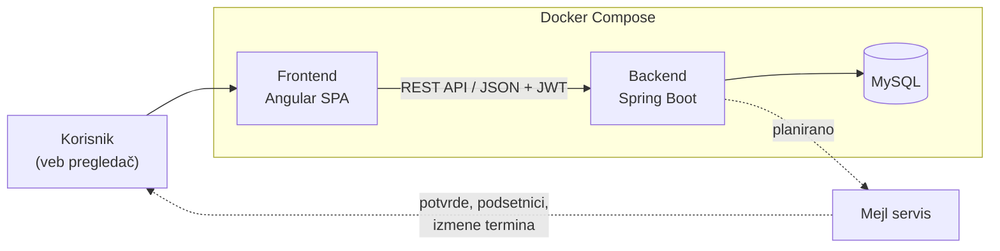

# ConsultMe

[](https://github.com/raboris10/USP_Projekat/actions/workflows/build.yml)

**Portal za zakazivanje konsultacija sa nastavnicima**

Studentski projekat iz predmeta *Upravljanje softverskim projektom*.

ConsultMe je veb aplikacija u kojoj profesori objavljuju termine konsultacija, studenti ih rezervišu i otkazuju, a sistem šalje potvrde, podsetnike i obaveštenja o izmenama.

> **Trenutno stanje:** na grani `main` nalazi se završen **MVP** (backend, frontend i baza, pokreću se jednom komandom kroz Docker). Uputstvo za pokretanje je u [`consultme/POKRETANJE.md`](consultme/POKRETANJE.md).

---

## Problem

Konsultacije se danas dogovaraju mejlom ili prema terminima sa sajta katedre i oglasne table. Termini se često menjaju, a informacija o promeni ne stiže pouzdano do svih studenata. Nastavnici gube vreme na prepisku, studenti dolaze uzalud, a evidencija o konsultacijama ne postoji.

## Rešenje

| | Danas | Sa ConsultMe |
|---|---|---|
| **Zakazivanje** | Mejl prepiska ili dolazak bez najave | Rezervacija slobodnog termina u nekoliko klikova |
| **Promena termina** | Sajt katedre, oglasna tabla, pojedinačni mejlovi | Automatsko obaveštenje svim prijavljenim studentima |
| **Pre termina** | Neizvesno da li je nastavnik u kabinetu | Potvrda i podsetnici 24 h, 12 h i 2 h pre termina |
| **Evidencija** | Ne postoji | Evidencija dolazaka i statistika opterećenja |

## Funkcionalnosti

U aplikaciji postoje tri uloge: **student**, **profesor** i **administrator**.

### Urađeno (MVP)

- Prijava sa JWT tokenom i prava pristupa po ulogama
- Profesor pravi termine (jednokratne i ponavljajuće svake nedelje), sa kapacitetom i mestom (kabinet ili link za onlajn sastanak)
- Profesor menja i otkazuje termine i vidi listu prijavljenih studenata sa temama
- Student pretražuje termine po profesoru, predmetu i datumu, rezerviše uz temu i otkazuje (najkasnije 2 h pre termina)
- Ograničenje broja aktivnih rezervacija po studentu (najviše 3)
- Notifikacije u aplikaciji: potvrda rezervacije, nova i otkazana rezervacija, izmena i otkazivanje termina
- Automatski podsetnici 24 h, 12 h i 2 h pre termina, za studente i profesore
- Administrator upravlja korisnicima (dodavanje, izmena, reset lozinke, deaktivacija), katedrama i predmetima
- Responzivan prikaz za računar, tablet i telefon, sa svetlom i tamnom temom

### Planirano

- Slanje notifikacija i mejlom (transakcioni mejl servis)
- Evidencija održanih konsultacija (dolazak / nedolazak)
- Statistika opterećenja po profesoru, predmetu i periodu, sa izvozom u CSV
- Eksterno bezbednosno testiranje i pilot na jednoj katedri

### Van okvira projekta

Mobilna aplikacija, video konsultacije, integracija sa studentskim informacionim sistemom, SMS obaveštenja.

## Tehnologije

| Sloj | Tehnologija |
|---|---|
| Frontend | Angular 21 (SPA, responzivan prikaz) |
| Backend | Java, Spring Boot 4 (REST API, Spring Security, JWT) |
| Baza podataka | MySQL 8.4 |
| Isporuka | Docker, Docker Compose |
| Verzionisanje | Git, GitHub |
| Praćenje zadataka | GitHub Issues, GitHub Projects |
| Notifikacije | U aplikaciji; mejl servis je planiran |

## Arhitektura



- **Frontend** je jednostranična aplikacija koja sa backendom komunicira isključivo preko REST API-ja. Uz svaki zahtev šalje JWT token.
- **Backend** sadrži poslovnu logiku (pravila rezervacije i otkazivanja, kapacitet, preklapanje termina), prava po ulogama, notifikacije i automatske podsetnike.
- **Baza** čuva korisnike, katedre, predmete, termine, rezervacije i notifikacije.
- Sve komponente rade u **Docker kontejnerima**, pa je okruženje isto kod svih članova tima.

### Model podataka

| Tabela | Opis |
|---|---|
| `korisnik` | Student, profesor ili administrator (jedna tabela, kolona `uloga`) |
| `katedra` | Katedra kojoj pripadaju predmeti |
| `predmet` | Predmet, pripada jednoj katedri |
| `profesor_predmet` | Koji profesor drži koji predmet (veza više-prema-više) |
| `termin` | Vreme, trajanje, mesto i kapacitet konsultacija jednog profesora; predmet je opcion |
| `rezervacija` | Student prijavljen na termin, sa temom, statusom i (kasnije) dolaskom |
| `notifikacija` | Obaveštenje za jednog korisnika, vezano za termin |

Tabele i test podatke pravi skripta [`consultme/db/init.sql`](consultme/db/init.sql).

## Struktura repozitorijuma

```
USP_Projekat/
├── docs/                        # projektna dokumentacija (PDF)
├── consultme/                   # aplikacija
│   ├── backend/                 # Spring Boot (REST API)
│   ├── frontend/                # Angular
│   ├── db/init.sql              # tabele i test podaci
│   ├── docker-compose.yml       # pokretanje sva tri kontejnera
│   ├── .env.example             # šablon za lični .env (lozinke, JWT ključ, portovi)
│   └── POKRETANJE.md            # detaljno uputstvo za pokretanje
└── README.md
```

## Pokretanje

Potrebni su samo **Git** i **Docker Desktop**.

```bash
git clone https://github.com/raboris10/USP_Projekat.git
cd USP_Projekat/consultme
cp .env.example .env        # pa u .env upisati svoje lozinke i JWT ključ
docker compose up --build
```

Aplikacija je na http://localhost:8087, a test nalozi su na stranici za prijavu.

Fajl `.env` se ne nalazi na GitHub-u, jer sadrži lozinke: svako ga pravi sam od šablona `.env.example`. Detalji, objašnjenje `.env` fajla i rešenja čestih problema su u [`consultme/POKRETANJE.md`](consultme/POKRETANJE.md).

## Dokumentacija

| Dokument | Opis |
|---|---|
| [Definicija projekta](docs/ConsultMe_Definicija_projekta.pdf) | Project Charter: ciljevi, opseg, rokovi, budžet, rizici, organizacija |
| [Studija izvodljivosti](docs/ConsultMe_Studija_izvodljivosti.pdf) | Feasibility Study: finansijska, tehnička, organizaciona, operativna, pravna i kulturološka izvodljivost |
| [Pokretanje aplikacije](consultme/POKRETANJE.md) | Instalacija, `.env`, nalozi, komande, česti problemi |

### Verzije dokumentacije

| Tag | Opis |
|---|---|
| `v0.1` | Prva verzija Definicije projekta |
| `v1.2` | Dopunjena Definicija projekta |
| `v2.0` | Definicija projekta v2.0 |
| `v2.0-potpisano` | Definicija projekta i Studija izvodljivosti v2.0, potpisane od strane tima |

## Način rada

- Svaka funkcionalnost razvija se na posebnoj grani, napravljenoj od ažurnog `main`-a:
  - `feature/...` za nove funkcionalnosti
  - `fix/...` za ispravke
  - `docs/...` za dokumentaciju
- U `main` se ulazi isključivo preko **Pull Request-a**, posle pregleda drugog člana tima.
- Grane se ne brišu nakon spajanja, da bi ostao trag rada.
- Poruke commit-a prate oblik `tip: opis`, npr. `feat: rezervacija termina`, `fix: provera kapaciteta`, `docs: ažuriran README`.
- Zadaci se vode kroz GitHub Issues i prate na kanban tabli u GitHub Projects.

## Tim

| Ime i prezime | Uloga |
|---|---|
| Boris Radosavljević | Menadžer projekta |
| Strahinja Stamenković | Backend |
| Uroš Novosel | Frontend |
